<!-- ═══════════════ HEADER ═══════════════ -->


<div align="center">


<br/>

**Receive, ship, transfer and count stock from a phone, connected live to Business Central.**

[Overview](#-overview) · [Demo](#-video-demo) · [Features](#-features) · [Screenshots](#-screenshots) · [How it works](#%EF%B8%8F-how-it-works) · [Backend APIs](#-business-central-apis) · [Contact](#-contact)

</div>

---

## 📱 Overview

**Tuwijri Inventory System** (نظام التويجري للمخزون) is a mobile app for store and warehouse teams at **Al Tuwijri for Men's Accessories**. It runs on **Microsoft Dynamics 365 Business Central** with **LS Central**.

Staff sign in, choose their store, and do their daily stock work on the phone: **receive purchase orders, return to vendors, receive and ship transfers, and count stock**. There's no need to go back to a PC.

The app downloads the store's master data once (**62,000+ items, 81,000+ barcodes, 1,000+ vendors**), so scanning and searching stay fast even on a weak connection. Every action goes into a **send queue** that syncs with Business Central automatically.

<table>
<tr>
<td align="center" width="25%">🛒<br/><b>Purchases</b><br/><sub>Receive POs, return to vendor</sub></td>
<td align="center" width="25%">🔁<br/><b>Transfers</b><br/><sub>Receive and ship between stores and warehouses</sub></td>
<td align="center" width="25%">📋<br/><b>Stock count</b><br/><sub>Count and send to the count worksheet</sub></td>
<td align="center" width="25%">🔍<br/><b>Item check</b><br/><sub>Scan a barcode, find the item</sub></td>
</tr>
</table>


## 🎬 Video demo

<div align="center">

<a href="docs/screenshots/WhatsApp%20Video%202026-11-26%20at%2009.25.49.mp4"></a>

<br/><br/>

<a href="docs/screenshots/WhatsApp%20Video%202026-11-26%20at%2009.25.49.mp4">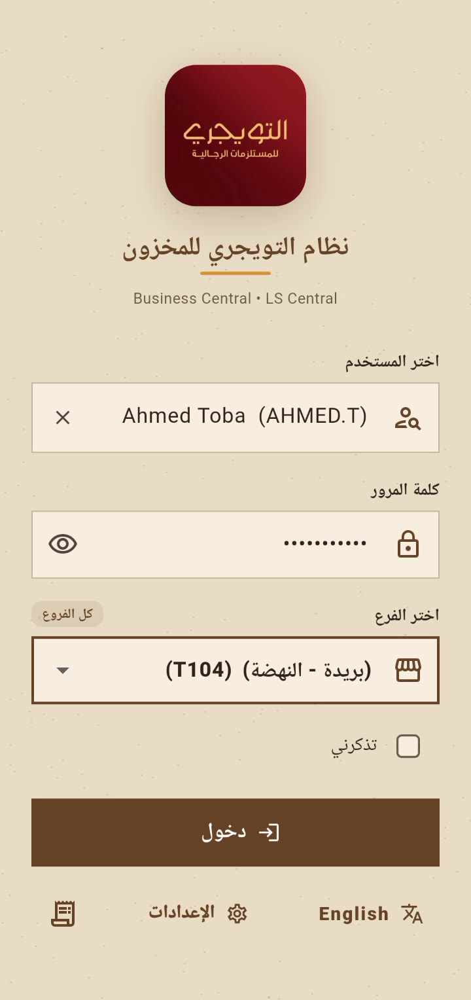</a>
<a href="docs/screenshots/WhatsApp%20Video%202026-11-26%20at%2009.25.49.mp4">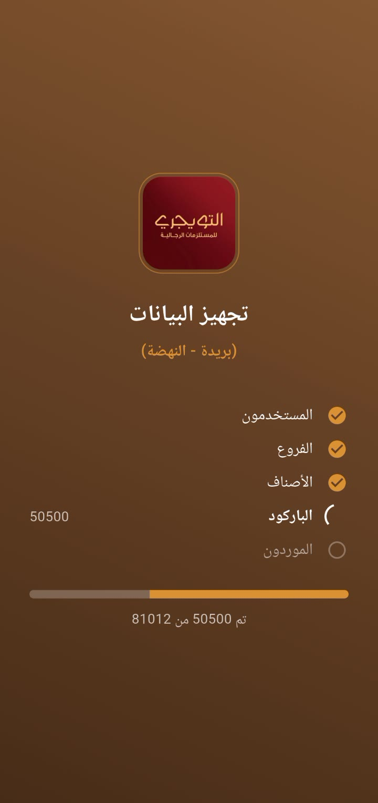</a>
<a href="docs/screenshots/WhatsApp%20Video%202026-11-26%20at%2009.25.49.mp4">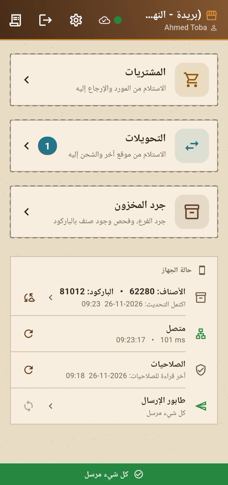</a>
<a href="docs/screenshots/WhatsApp%20Video%202026-11-26%20at%2009.25.49.mp4">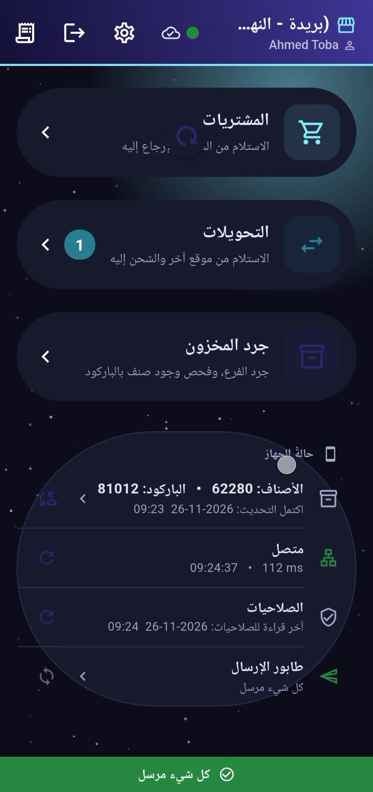</a>

<sub>A 3-minute tour: sign-in → data preparation → purchases → transfers → stock count → settings and themes.<br/>Click the button or any screen to open the video.</sub>

</div>

---

---

## ✨ Features

<table>
<tr>
<td width="50%" valign="top">

### 🔐 Sign-in & permissions
- Search users by name or code
- Password sign-in, with **remember me**
- Choose the **store** the user works in; users with access to all stores see every branch
- **Permissions** read from Business Central control what each user can do

</td>
<td width="50%" valign="top">

### ⚡ Data preparation (first start)
- Downloads **users, stores, items, barcodes and vendors** for the selected store
- Live progress for each step (e.g. *50,500 of 81,012 barcodes*)
- Data is kept on the device for fast scanning and search

</td>
</tr>
<tr>
<td width="50%" valign="top">

### 🛒 Purchases
- **Receive from vendor**: receive goods against a purchase order for this store
- **Return to vendor**: send items back to the vendor
- Vendor list stored on the device (1,058 vendors)

</td>
<td width="50%" valign="top">

### 🔁 Transfers
- **Receive from another location**: incoming transfer orders, with a badge showing how many are waiting
- **Ship to another location**: send items to a store or warehouse
- Works **live** with Business Central: quantities are written straight to the transfer order

</td>
</tr>
<tr>
<td width="50%" valign="top">

### 📋 Stock count
- **Stock count**: count items and send them to the store's count worksheet
- **Item check**: scan or type a barcode to confirm an item exists
- Count orders list, with **New count**

</td>
<td width="50%" valign="top">

### 📶 Device status & sync
- Items and barcodes on the device, with the time of the last update
- Connection status and response time (ms)
- Last permissions refresh
- **Send queue**: a green "everything sent" bar when all work has reached Business Central

</td>
</tr>
<tr>
<td width="50%" valign="top">

### 🎨 Themes
- 6 built-in themes: **Carton**, **Space**, **Green terminal**, **Blueprint**, **Tuwijri**, **LS Central**
- Ready-made accent colours

</td>
<td width="50%" valign="top">

### 🛠️ Settings & support
- **Test connection** to Business Central
- **Error log** with clear messages for troubleshooting
- **Arabic / English**, full right-to-left support
- Danger zone: **clear local data** (items and unsent counts)

</td>
</tr>
</table>

---

## 📷 Screenshots

<table>
<tr>
<td align="center" width="33%"><br/><sub><b>Sign in</b>: user, password, store</sub></td>
<td align="center" width="33%">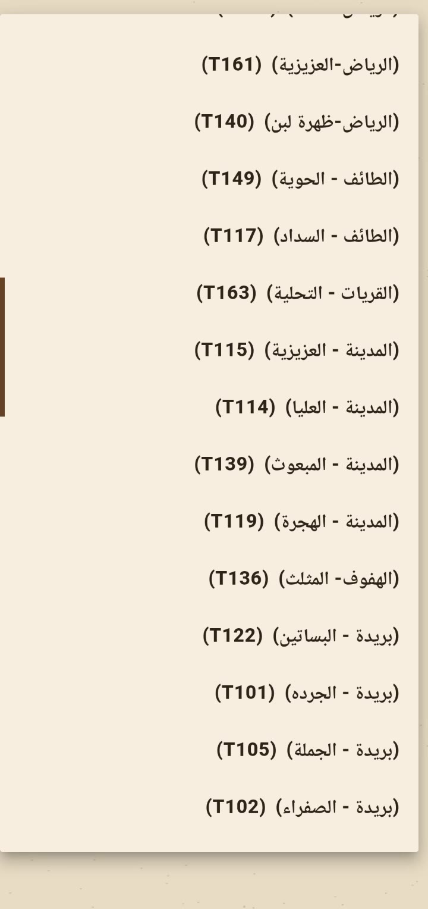<br/><sub><b>Store selection</b></sub></td>
<td align="center" width="33%"><br/><sub><b>Data preparation</b> with live progress</sub></td>
</tr>
<tr>
<td align="center"><br/><sub><b>Home</b> and device status</sub></td>
<td align="center">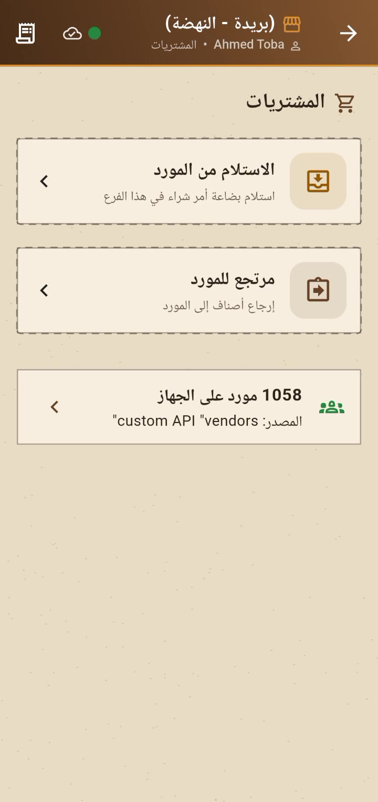<br/><sub><b>Purchases</b>: receive and return</sub></td>
<td align="center">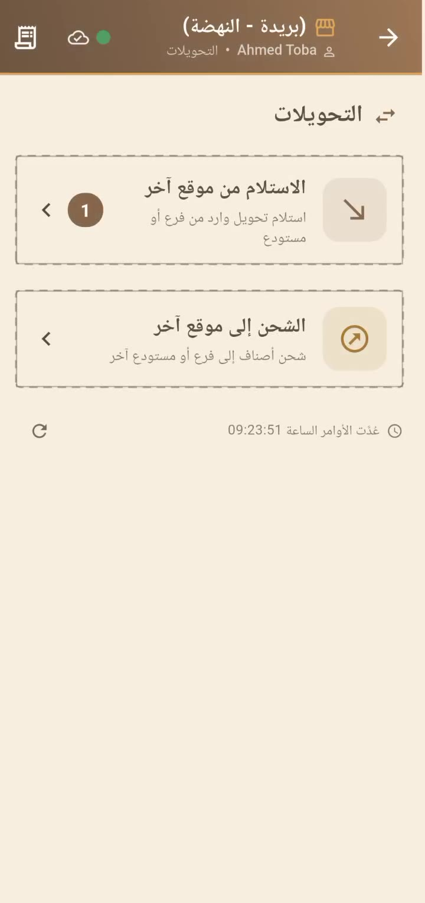<br/><sub><b>Transfers</b>: receive and ship</sub></td>
</tr>
<tr>
<td align="center"><br/><sub><b>Incoming transfer</b> order</sub></td>
<td align="center">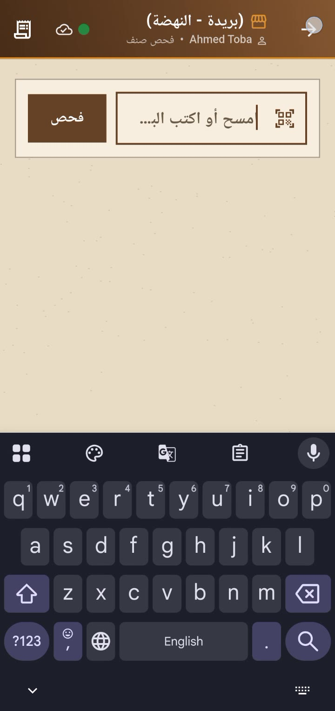<br/><sub><b>Item check</b> by barcode</sub></td>
<td align="center">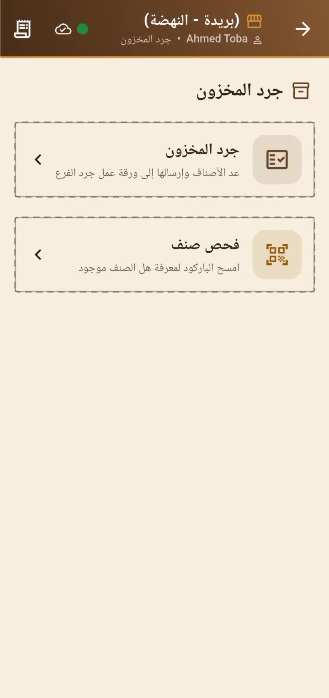<br/><sub><b>Stock count</b></sub></td>
</tr>
<tr>
<td align="center">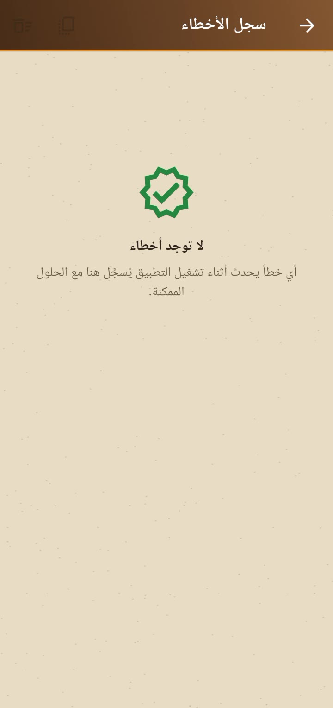<br/><sub><b>Error log</b></sub></td>
<td align="center">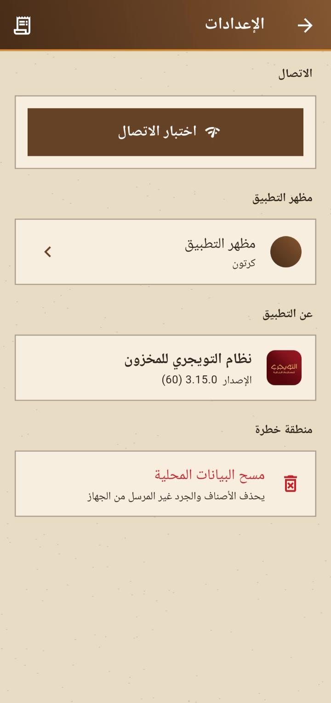<br/><sub><b>Settings</b></sub></td>
<td align="center">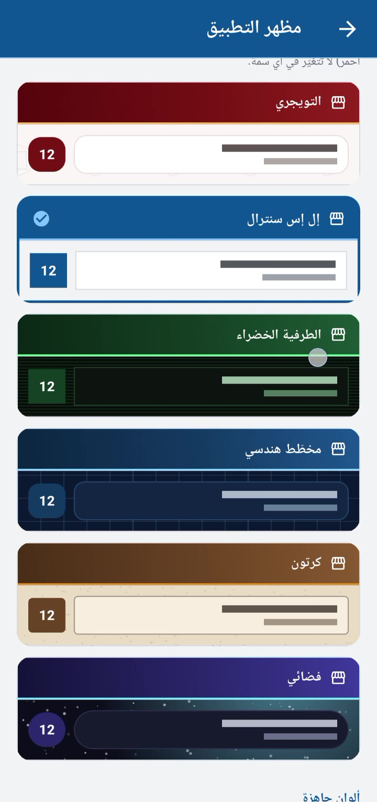<br/><sub><b>Themes</b></sub></td>
</tr>
<tr>
<td></td>
<td align="center"><br/><sub><b>Home</b> in the Space theme</sub></td>
<td></td>
</tr>
</table>

---

## ⚙️ How it works

```
┌──────────────────────────┐        HTTPS / OData        ┌───────────────────────────────┐
│   Tuwijri Inventory app  │  ─────────────────────────▶ │  Business Central + LS Central │
│   (Android)              │                             │                               │
│                          │  ◀───────────────────────── │  Custom AL API pages           │
│  • Local data: items,    │   items, barcodes, vendors, │  • Users & permissions         │
│    barcodes, vendors     │   stores, users, orders     │  • Items, barcodes, vendors    │
│  • Send queue (sync)     │                             │  • Purchase / receiving / TO   │
│  • Error log             │                             │  • Count worksheet             │
└──────────────────────────┘                             └───────────────────────────────┘
```

1. **Sign in**: the app checks the user and their permissions against Business Central.
2. **Prepare data**: items, barcodes and vendors for the chosen store are downloaded to the device.
3. **Work**: scanning and searching use local data, so they're instant.
4. **Sync**: receipts, returns and counts go into the send queue and post to Business Central. Transfers are written live.

---

## 🔌 Business Central APIs

The backend is a custom **AL extension** for Business Central and LS Central. It exposes API pages and the tables for app users and permissions.

| Area | API pages / objects |
|---|---|
| **Users & permissions** | App User, App Permission, App User Permission (tables, pages and APIs), Set Password dialog |
| **Master data** | Store Master, Item Barcode, Item by Location, Vendor |
| **Purchasing** | Purchase Order, Purchase Lines, Retail Receiving Header / Lines |
| **Returns** | Purchase Return Order / Lines, Retail Picking / Lines |
| **Transfers** | Transfer Order, Transfer Lines |
| **Stock count** | Worksheet, Lines |

Built with: `AL` · `API pages` · `Codeunits` · `Batch & single-line insert` · `LS Central`

---

## 🧰 Tech stack

| Part | Technology |
|---|---|
| ERP | Microsoft Dynamics 365 Business Central (on-prem) + LS Central |
| Backend | AL extension: API pages, tables, codeunits |
| Mobile app | Android · **[framework, e.g. Flutter / React Native / .NET MAUI]** |
| Integration | REST / OData v4 |

---

## 🔒 Availability

This is an **internal company application**. The source code and server details aren't public. This repository is a showcase of the project.

---

## 📬 Contact

<div align="center">

<a href="https://www.linkedin.com/in/ahmed-toba-7378b0206/"></a>
<a href="mailto:ahmedtobashahban21@gmail.com"></a>

<br/><br/>

<sub>Designed and built by <a href="https://github.com/ahmedtobashahban21">Ahmed Toba Shaban</a></sub>

</div>


